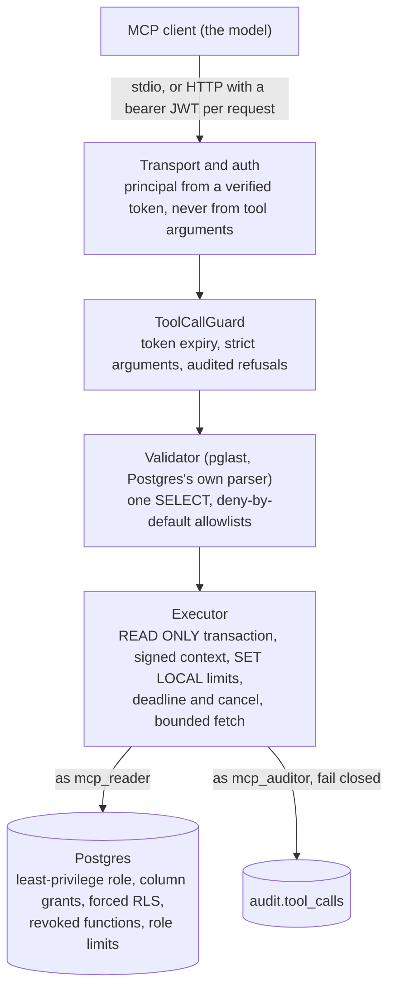
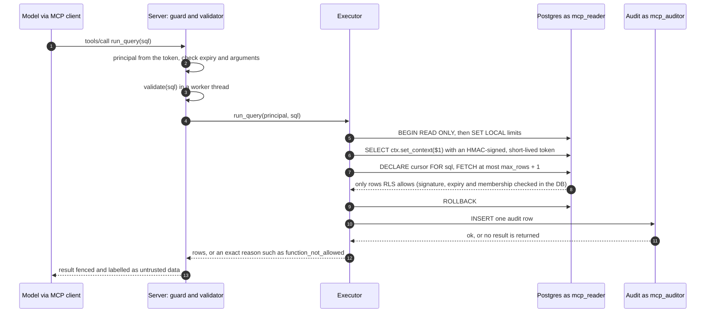

# pg-mcp-guard

[](https://github.com/M-Haris346/pg-mcp-guard/actions/workflows/ci.yml)
[](LICENSE)


**Demo video:** the real server driven by a real MCP client: RLS, column grants, the `COMMIT; DROP` attack, a prompt-injection row and the audit log.

[](https://youtu.be/3TNNtByp2D8)


An MCP server that lets an LLM agent run read-only SQL against PostgreSQL, where safety is enforced
by the database first and by a SQL validator second, never by the prompt. The tests prove that a
model can only read rows and columns its principal may read, cannot change anything, cannot exhaust
the database, and is audited, even when the validator is switched off.

## Why

The archived reference Postgres MCP server ran model-written SQL inside a `READ ONLY` transaction,
and a multi-statement string (`COMMIT; DROP ...`) escaped it. See Datadog Security Labs, "MCP
vulnerability case study: SQL injection in the PostgreSQL MCP server". A read-only transaction, or
a filter on the SQL text, is one layer. This repo shows a layered fix, and tests each layer on its
own.

## How it works



One `run_query` call:



## Defence in depth

| Layer | What it stops | Proof |
|---|---|---|
| **Postgres role and grants** | writes, DDL, catalog and audit reads, `email` / `phone`, large objects, cancelling other sessions, changing any setting (`set_config` revoked) | [tests/db/test_grants.py](tests/db/test_grants.py), [tests/db/test_set_config.py](tests/db/test_set_config.py) (validator off) |
| **Row-level security + signed context** | another tenant's rows; forged, tampered or expired contexts; non-members | [tests/db/test_rls.py](tests/db/test_rls.py) (validator off) |
| **Role limits** | long queries, lock waits, huge spilling sorts, connection floods | [tests/db/test_limits.py](tests/db/test_limits.py) (validator off) |
| **Validator** | anything but one `SELECT`; functions, relations, types and operators off the allowlists, wherever they hide | [tests/validator/](tests/validator/) (adversarial corpus) |
| **Executor** | multi-statement strings, unbounded results, queries past the deadline, state left for the next caller, unaudited calls | [tests/executor/](tests/executor/) (many with the validator off) |
| **Transport and auth** | identity from tool arguments, bad or expired tokens, session-id reuse, DNS rebinding, oversized bodies, tokens in logs | [tests/mcp/](tests/mcp/), [tests/http/](tests/http/) |

The full attack → control → test table, with residual risks, is in the
[threat model](docs/threat-model.md).

### Why many tests run with the validator disabled

This is deliberate. A validator is code, and code has bugs. The claim this project makes is that
the **database** holds even when the validator lets something through. So the database tests
connect as the real runtime role and send attacks straight to Postgres, and many executor and HTTP
tests replace the validator with one that allows everything. The validator has its own corpus of
attacks with expected verdicts, and a meta-test fails if a database attack test has no
matching corpus entry.

## Quickstart

Needs Docker and [uv](https://docs.astral.sh/uv/).

```
uv run python scripts/dev_setup.py      # .env with fresh secrets, Postgres, migrations, demo data
uv run python scripts/demo.py           # the real server, driven by a real MCP client
```

- **`dev_setup.py`** creates `.env` only if it does not exist, and never prints secrets. If port
  5432 is taken, use `--port 5433`.
- **`demo.py`** shows each scene's question, the SQL and the outcome, and exits non-zero if any
  scene misbehaves. `--pause` waits for Enter between scenes (for recording); `--no-color` gives
  plain output.

To connect Claude Desktop, Claude Code or MCP Inspector (stdio or HTTP), see
[docs/clients.md](docs/clients.md).

## Development

```
uv run pytest                            # migrates and seeds its own mcpguard_test database
uv run ruff check . && uv run ruff format --check . && uv run mypy app
uv run python -m scripts.mint_token --user alice --tenant acme --ttl 1h   # dev only
MCP_PRINCIPAL_TOKEN=<token> uv run python -m app.server                    # stdio
uv run python -m app.server --transport http                                # 127.0.0.1:8765/mcp
```

Design decisions are recorded in [docs/decisions/](docs/decisions/README.md).

## Implemented / Tested

- **Database layer** ([ADR 0002](docs/decisions/0002-signed-rls-context.md)):
  - roles `mcp_migrator`, `mcp_rls_helper`, `mcp_reader`, `mcp_auditor`;
  - forced RLS keyed to an HMAC-signed context verified in Postgres;
  - column grants and `security_invoker` views;
  - role-level limits;
  - revoked `set_config`, stats, cancel and large-object functions;
  - an append-only audit table.
- **Validator** ([ADR 0003](docs/decisions/0003-validator-pglast.md)): pglast at Postgres 18.6,
  deny by default, adversarial corpus. Every allowed query is also run against the real database.
- **Executor** ([ADR 0004](docs/decisions/0004-executor.md)):
  - read-only transaction;
  - server-side cursor over the extended protocol;
  - byte and row caps;
  - deadline, cancel and backstop;
  - `DISCARD ALL`;
  - mapped errors;
  - fail-closed audit, including cancellations.
- **MCP server over stdio** ([ADR 0005](docs/decisions/0005-mcp-server.md)):
  - three read-only tools with strict inputs;
  - principal from a verified JWT, expiry checked per call;
  - untrusted-data fence;
  - fail-closed startup checks.
- **Streamable HTTP** ([ADR 0006](docs/decisions/0006-http-transport.md)):
  - bearer token on every request through the SDK's auth path, audited 401s;
  - isolation of principals in one process;
  - loopback by default, DNS-rebinding protection, body and session limits.
- **Demo and setup:** `scripts/demo.py` (checked in CI), `scripts/dev_setup.py`.

## Planned

- Record the demo video ([shot list](docs/demo-video.md)).
- An asymmetric token verifier (OIDC / JWKS) as an alternative to the HS256 shared secret.

## Limitations

- **Exfiltration by the client:** the server limits what a principal can read, not what the MCP
  client does with it afterwards.
- **HS256 shared secret:** in stdio mode the operator can mint any identity.
- **No TLS:** use a reverse proxy for anything beyond loopback.
- More, with the reasoning, in the [threat model](docs/threat-model.md#residual-risks).

## How this was built

I built this with Claude Code, working from my own specification ([CLAUDE.md](CLAUDE.md)) one phase
at a time. Each phase started as a plan that I reviewed, amended and approved before any code was
written. I then reviewed the output and the real test runs, and pushed back with changes where
needed; several of the security fixes came out of that review. I can explain every design decision
in this repository, and the reasoning is written down in the ADRs.

## License

[MIT](LICENSE)
